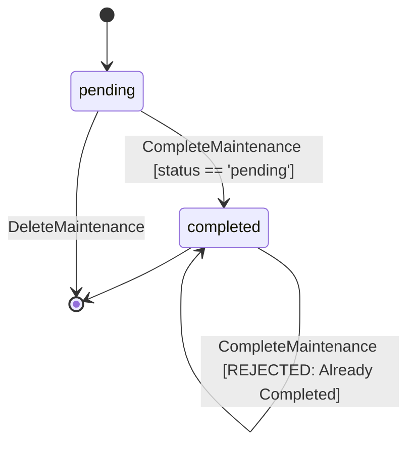
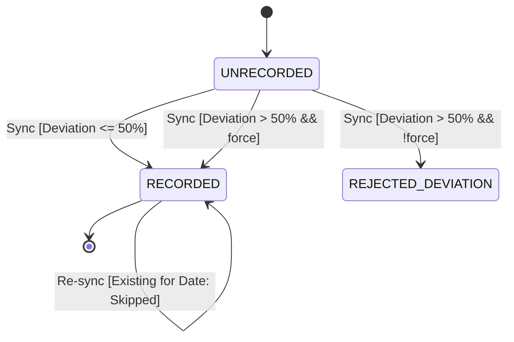

# State Machines Specification & Audit (`STATE_MACHINES.md`)

> **Single Source of Truth (SSOT)** for all application state machines, invariants, transition tables, reachability audits, and concurrency regression tests across iERP.  
> **Last Updated**: 2026-11-08  
> **Audited by**: Antigravity (`/state-machines`)

---

## 📑 State Machine Inventory

| Machine Name | Domain / Subsystem | Type | Location | Status |
| :--- | :--- | :--- | :--- | :--- |
| `MaintenanceItemLifecycle` | Preventive Maintenance / LifeOps | Explicit (`status` column) | [`internal/lifeops/lifeops.go`](file:///home/al/Projects/ierp/internal/lifeops/lifeops.go#L118-L195) | 🟢 Hardened (`SM-01` Fixed) |
| `SnapshotIngestionPipeline` | Portfolio & Sovereign Runway | Guarded Ingestion Pipeline | [`internal/portfolio/sync.go`](file:///home/al/Projects/ierp/internal/portfolio/sync.go#L103-L135) | 🟢 Hardened (`SM-02` Fixed) |
| `R2SyncLifecycle` | Cloudflare R2 Sync & Backup | Distributed State Machine | [`internal/r2/r2.go`](file:///home/al/Projects/ierp/internal/r2/r2.go#L447-L573) | 🟢 Hardened (`SM-03` Fixed) |
| `DecisionLifecycle` | Decision Journal & Calibration | Explicit (`status` column) | [`internal/decisions/decisions.go`](file:///home/al/Projects/ierp/internal/decisions/decisions.go#L55-L71) | 🟢 Hardened (`SM-04` Fixed) |
| `RadarCadenceEngine` | CRM & Dunbar Reconnection Engine | Dynamic Cadence Evaluator | [`internal/radar/radar.go`](file:///home/al/Projects/ierp/internal/radar/radar.go#L28-L117) | 🟢 Clean |
| `PetiteVueStoreLifecycle` | Embedded Dashboard Frontend | Implicit (Reactive Flags) | [`internal/dashboard/assets/static/js/app.js`](file:///home/al/Projects/ierp/internal/dashboard/assets/static/js/app.js#L37-L280) | 🟢 Clean |

---

## 1. `MaintenanceItemLifecycle` Specification

### 1.1 Context & Purpose
Governs preventive maintenance schedules, physical asset servicing, recurring renewals, and task auto-rescheduling. Persisted in SQLite `maintenance_items(status)`.

### 1.2 States Definition

| State | Classification | Description |
| :--- | :--- | :--- |
| `pending` | Initial / Active | Scheduled task waiting for completion or due date arrival. |
| `completed` | Terminal (for current record) | Task marked finished with recorded cost and execution timestamp. |
| `deferred` | Intermediate | Task rescheduled without completion. |

### 1.3 System Invariants
1. **Single Completion Law**: A maintenance item can transition from `pending` to `completed` exactly once. Re-completing an already completed item must fail cleanly.
2. **Deterministic Rescheduling**: Completing a recurring item (`interval_days > 0`) must spawn exactly ONE successor item with status `pending` scheduled at `completion_date + interval_days`.
3. **Concurrency Safety**: Concurrent completion requests on the same item ID must never spawn duplicate successor items.

### 1.4 Transition Table

| From State | Event / Trigger | Guard Condition | To State | Side Effects & Actions |
| :--- | :--- | :--- | :--- | :--- |
| `pending` | `CompleteMaintenance` | Task exists AND `status != 'completed'` | `completed` | Update final cost; if `interval_days > 0`, insert single successor `pending` item. |
| `completed`| `CompleteMaintenance` | Any | `completed` (Rejected) | Abort transaction with `"item is already completed"`; no duplicate created. |
| `pending` | `DeleteMaintenance` | Task exists | [*] (Deleted) | Row removed from database. |

### 1.5 State Diagram



---

## 2. `SnapshotIngestionPipeline` Specification

### 2.1 Context & Purpose
Governs balance sheet snapshot ingestion from automated portfolio aggregators into the central SSOT (`networth_snapshots`), computing sovereign runway and enforcing deviation guards.

### 2.2 States Definition

| State | Classification | Description |
| :--- | :--- | :--- |
| `UNRECORDED` | Initial | Snapshot date does not yet exist in `networth_snapshots`. |
| `RECORDED` | Terminal | Snapshot ingested with liquid cash, investments, liabilities, and calculated net worth. |
| `REJECTED_DEVIATION` | Guarded Failure | Snapshot rejected due to > 50% liquid cash swing without `--force`. |

### 2.3 System Invariants
1. **Date-Level Idempotency**: Re-ingesting an already recorded date must skip insertion and log informational notice, regardless of whether newer snapshots exist.
2. **Chronological Deviation Guard**: Liquid cash swings exceeding 50% relative to the latest snapshot require explicit `--force`.
3. **Non-Destructive Backfills**: Ingesting historical snapshots must not trigger false deviation alerts against future snapshots.

### 2.4 Transition Table

| From State | Event / Trigger | Guard Condition | To State | Side Effects & Actions |
| :--- | :--- | :--- | :--- | :--- |
| `UNRECORDED` | `SyncPortfolio` | Date not in DB AND `deviation <= 50%` | `RECORDED` | Insert snapshot; seed initial baseline commitments if none active; calculate runway. |
| `UNRECORDED` | `SyncPortfolio` | Date not in DB AND `deviation > 50%` AND `!force` | `REJECTED_DEVIATION`| Abort non-zero with deviation warning. |
| `UNRECORDED` | `SyncPortfolio` | Date not in DB AND `deviation > 50%` AND `force` | `RECORDED` | Insert snapshot with warning log; recalculate runway. |
| `RECORDED` | `SyncPortfolio` | Snapshot already exists for `dateStr` | `RECORDED` (Skipped) | Log notice that snapshot is already recorded; avoid duplicate rows. |

### 2.5 State Diagram



---

## 3. `R2SyncLifecycle` Specification

### 3.1 Context & Purpose
Coordinates Cloudflare R2 S3-compatible remote database synchronization with local SQLite WAL database files.

### 3.2 States Definition

| State | Classification | Description |
| :--- | :--- | :--- |
| `LOCAL_ONLY` | Initial / Diverged | Remote R2 object does not exist; local SQLite exists. |
| `REMOTE_ONLY` | Initial / Restoring| Local database does not exist; remote R2 snapshot exists. |
| `IN_SYNC` | Stable / Terminal | Local MD5 hash matches remote R2 ETag. |
| `LOCAL_NEWER` | Active Mutation | Local modifications occurred since last sync or local timestamp > remote. |
| `REMOTE_NEWER`| Remote Mutation | Remote snapshot modified from another workstation (> 60s newer). |
| `DIVERGED` | Conflict | Hashes differ with close timestamps (< 60s); tiebreak required. |

### 3.3 System Invariants
1. **WAL Checkpoint Invariant**: A database cannot be pushed or hashed until `PRAGMA wal_checkpoint(TRUNCATE)` cleanly flushes dirty WAL journal pages into the primary file.
2. **Integrity Guard**: A pulled remote database must pass `PRAGMA integrity_check == 'ok'` before atomic replacement of the local file.
3. **Backup Before Mutation**: A local backup copy must always be staged before downloading or replacing the SQLite database.

### 3.4 Transition Table

| From State | Event / Trigger | Guard Condition | To State | Side Effects & Actions |
| :--- | :--- | :--- | :--- | :--- |
| `LOCAL_NEWER` | `Push` | `CheckpointDB() == nil` | `IN_SYNC` | Stage backup; upload to R2 via SigV4 PUT; save sync state. |
| `REMOTE_NEWER`| `Pull` | Integrity check passes | `IN_SYNC` | Download to temp file; verify integrity; atomic rename to `events.db`. |
| `*` | `AutoSync` | `diff > 60s` | `IN_SYNC` | Execute `Push` after verified WAL checkpoint. |
| `*` | `AutoSync` | `diff < -60s` | `IN_SYNC` | Execute `Pull` with pre-backup. |

---

## 4. Reachability & Vulnerability Audit (With Evidence)

### 🔴 Bug ID: `SM-01` — LifeOps Task Duplication on Re-Completion & Concurrency
- **Affected Machine**: `MaintenanceItemLifecycle`
- **Location**: [`internal/lifeops/lifeops.go`](file:///home/al/Projects/ierp/internal/lifeops/lifeops.go#L118-L175)
- **Severity**: P1 (High)
- **Violation**: Completing an already completed item or concurrent requests triggered multiple task reschedules and scheduled duplicate recurring tasks.
- **Trigger Vectors**:
  - [x] Network retries of `/api/maintenance/{id}/complete`
  - [x] Double-click / concurrent HTTP requests
  - [x] Calling `CompleteMaintenance` on an already completed task
- **Execution Trace**:
  ```go
  // Prior code: SELECT did not query status and UPDATE lacked status guard:
  row := tx.QueryRow(`SELECT id, name, ... interval_days FROM maintenance_items WHERE id = ?`, itemID)
  // Even if item was 'completed', update succeeded:
  tx.Exec(`UPDATE maintenance_items SET status = 'completed' WHERE id = ?`, itemID)
  // If interval_days > 0, an extra pending task was inserted unconditionally:
  tx.Exec(`INSERT INTO maintenance_items ... VALUES (..., 'pending')`)
  ```
- **Reproduction Test**: `TestLifeOpsAndAutoReschedule` and `TestCompleteMaintenance_ConcurrentDoubleExecution` in [`internal/lifeops/lifeops_test.go`](file:///home/al/Projects/ierp/internal/lifeops/lifeops_test.go#L63-L135).
- **Remediation**:
  1. Added `COALESCE(status, 'pending')` to item lookup and early abort if `status == 'completed'`.
  2. Enforced atomic CAS transition guard: `UPDATE maintenance_items ... WHERE id = ? AND status != 'completed'`.
  3. Checked `rowsAffected == 0` to block concurrent execution.

---

### 🔴 Bug ID: `SM-02` — Out-of-Order Snapshot Ingestion Duplication & False Deviation Alert
- **Affected Machine**: `SnapshotIngestionPipeline`
- **Location**: [`internal/portfolio/sync.go`](file:///home/al/Projects/ierp/internal/portfolio/sync.go#L103-L131)
- **Severity**: P1 (High)
- **Violation**: Re-syncing an existing snapshot date when a newer snapshot was present created duplicate rows and triggered false deviation errors.
- **Trigger Vectors**:
  - [x] Historical snapshot backfilling
  - [x] Re-running sync for past dates
- **Execution Trace**:
  ```go
  // Prior code: Checked only GetLatestSnapshot:
  existing, _ := finance.GetLatestSnapshot(db) // Returned 2026-10-02
  if existing.SnapshotDate != "2026-10-01" {    // Always true!
      // Ingested duplicate row for 2026-10-01 instead of recognizing it!
  }
  ```
- **Reproduction Test**: `TestSyncPortfolio` in [`internal/portfolio/sync_test.go`](file:///home/al/Projects/ierp/internal/portfolio/sync_test.go#L125-L144).
- **Remediation**:
  1. Added `finance.GetSnapshotByDate(db, dateStr)` to check for date presence in the SSOT.
  2. Skip duplicate insertions with informational log when `existingForDate != nil`.
  3. Evaluated deviation against the latest snapshot only when adding a new date.

---

### 🟡 Bug ID: `SM-03` — Silent R2 Upload of Uncheckpointed SQLite WAL
- **Affected Machine**: `R2SyncLifecycle`
- **Location**: [`internal/r2/r2.go`](file:///home/al/Projects/ierp/internal/r2/r2.go#L323)
- **Severity**: P2 (Medium)
- **Violation**: Ignored `CheckpointDB` error (`_ = CheckpointDB(dbPath)`) permitted uploading dirty SQLite main database files during active locks.
- **Remediation**: Enforced explicit error handling: abort `Push` and `AutoSync` if WAL truncation fails.

---

### 🟡 Bug ID: `SM-04` — Decision Status Arbitrary String Mutation
- **Affected Machine**: `DecisionLifecycle`
- **Location**: [`internal/decisions/decisions.go`](file:///home/al/Projects/ierp/internal/decisions/decisions.go#L56-L65)
- **Severity**: P2 (Medium)
- **Violation**: Reviewing decisions allowed arbitrary string status inputs without validation.
- **Remediation**: Validated review status against allowed states (`reviewed`, `abandoned`, `pending`).

---

## 5. Verification & Regression Checklist

- [x] All reported invalid states have reproducing automated regression tests.
- [x] Concurrency/race conditions tested with 10 parallel goroutines (`TestCompleteMaintenance_ConcurrentDoubleExecution`).
- [x] Transition tables and invariants in this document are aligned with code.
- [x] 100% test suite pass rate: `go test -v ./...` passes across all packages.
- [x] Static binary compiles cleanly: `go build -o bin/ierp ./cmd/ierp`.
